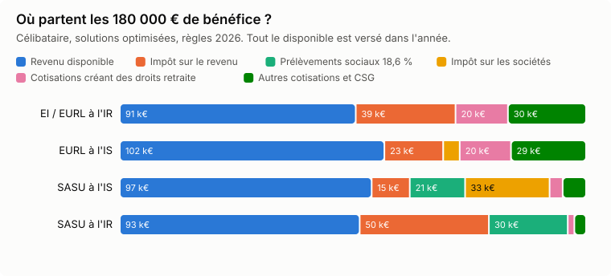
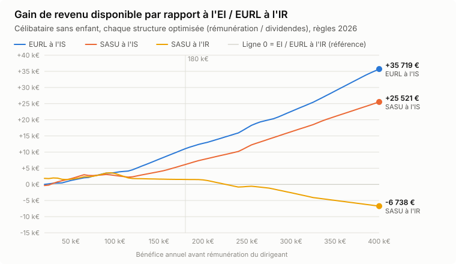
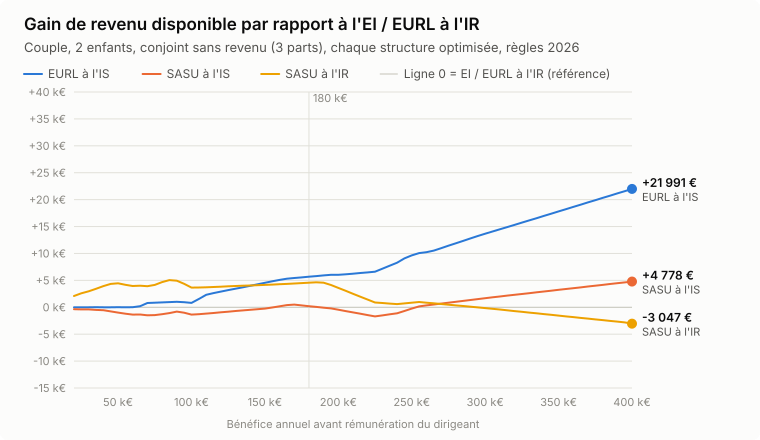

# 180 000 € de bénéfice : EI, EURL ou SASU ? J'ai refait tous les calculs avec les règles 2026

*Temps de lecture : 15 minutes. Simulateur en fin d'article pour tester votre propre situation.*

« Passe en SASU, tu te verseras des dividendes, c'est beaucoup moins chargé. »

Si vous êtes indépendant et que vos affaires marchent, quelqu'un vous a forcément sorti cette phrase. Un ami, un forum, parfois même un expert-comptable pressé. Elle avait un fond de vérité il y a quelques années. En 2026, pour un bénéfice de 180 000 €, elle est fausse. Et pas de quelques euros.

J'ai pris un cas simple, je l'ai passé dans un moteur de calcul calibré au centime près sur ceux de l'Urssaf, et j'ai comparé les quatre options sérieuses. Résultat : à 180 000 € de bénéfice, l'**EURL à l'impôt sur les sociétés** laisse **102 142 € par an** dans la poche d'un célibataire, soit **4 903 € de plus que la SASU** et **11 053 € de plus que l'entreprise individuelle**. Et cerise sur le gâteau, elle lui ouvre environ trois fois plus de droits à la retraite que la SASU optimisée.

Je vous montre tout : le cas, les chiffres, les raisons, les points de bascule selon votre bénéfice, ce que vos cotisations vous achètent réellement, et les limites de l'exercice. Parce qu'un chiffre sans ses hypothèses, c'est du marketing.

---

## Le cas étudié

- Un consultant indépendant (disons du conseil en immobilier) qui dégage **180 000 € de bénéfice par an**, avant sa propre rémunération. Pas de charges : chiffre d'affaires = bénéfice.
- Il veut **maximiser son revenu disponible** : ce qui lui reste après cotisations sociales, impôt sur les sociétés, prélèvements sociaux et impôt sur le revenu. Tout le bénéfice est versé dans l'année, rien n'est laissé en réserve.
- Cas de base : **célibataire, sans enfant, sans autre revenu**. J'ai aussi testé un couple avec deux enfants et un couple dont le conjoint est salarié.
- Règles **2026** : plafond de la Sécurité sociale (PASS) à 48 060 €, barème de l'impôt sur le revenu de la loi de finances pour 2026, prélèvement forfaitaire unique (PFU) à 31,4 %, réforme de l'assiette des cotisations des indépendants.

Quatre structures en lice, chacune **optimisée** : pour chacune, j'ai testé toutes les répartitions possibles entre rémunération et dividendes et retenu la meilleure.

1. **EI ou EURL à l'IR** : tout le bénéfice est votre revenu, soumis aux cotisations des travailleurs non salariés (TNS) puis à l'impôt sur le revenu.
2. **EURL à l'IS** : vous êtes gérant majoritaire (TNS), la société paie l'IS, vous vous versez une rémunération et éventuellement des dividendes.
3. **SASU à l'IS** : vous êtes président « assimilé salarié », la société vous verse un salaire et des dividendes.
4. **SASU à l'IR** : l'option temporaire (5 exercices maximum, société de moins de 5 ans) où le bénéfice est imposé directement à votre nom.

## Le verdict en un tableau

| Structure (optimisée) | Ce que vous vous versez | Revenu disponible | Écart avec la meilleure |
|---|---|---|---|
| **EURL à l'IS** | 137 500 € de rémunération (coût société) + 36 125 € de dividendes | **102 142 €** | référence |
| SASU à l'IS | 23 352 € de salaire brut + 114 850 € de dividendes | 97 239 € | −4 903 € |
| SASU à l'IR | 11 735 € de salaire brut + 163 651 € de bénéfice imposé à votre nom | 92 603 € | −9 539 € |
| EI / EURL à l'IR | les 180 000 € | 91 089 € | −11 053 € |

*Célibataire sans enfant, règles 2026, chaque structure optimisée.*

Et voici où partent les 180 000 € dans chaque cas :

| | EI / EURL IR | EURL IS | SASU IS | SASU IR |
|---|---|---|---|---|
| Impôt sur les sociétés | 0 € | 6 375 € | 32 617 € | 0 € |
| Cotisations sociales | 50 385 € | 48 776 € | 14 082 € | 7 077 € |
| *dont cotisations qui créent des droits retraite* | *20 229 €* | *19 793 €* | *5 055 €* | *2 540 €* |
| Prélèvements sociaux (18,6 %) | 0 € | 19 € | 21 362 € | 30 439 € |
| Impôt sur le revenu | 38 527 € | 22 689 € | 14 701 € | 49 882 € |
| **Total prélevé** | **88 911 € (49,4 %)** | **77 858 € (43,3 %)** | **82 761 € (46,0 %)** | **87 397 € (48,6 %)** |

Regardez la ligne en italique. Elle est importante, on y revient plus bas.

## Pourquoi l'EURL à l'IS gagne (alors que tout le monde vous vend la SASU)

### 1. Les 10 % que l'EI ne vous donnera jamais

En EI ou en EURL à l'IR, votre bénéfice est imposé comme un bénéfice (BIC ou BNC) : pas d'abattement. En EURL à l'IS, votre rémunération de gérant majoritaire est imposée selon les règles des traitements et salaires (article 62 du CGI, qui renvoie à l'[article 83 du CGI](https://www.legifrance.gouv.fr/codes/article_lc/LEGIARTI000037985819/)), avec l'**abattement forfaitaire de 10 % pour frais professionnels** (plafonné à 14 555 € dans le barème 2026).

Même bénéfice, mêmes cotisations, mais 14 555 € de revenu imposable en moins. À une tranche marginale de 41 %, ça fait **+5 472 € par an**, juste en changeant d'option fiscale et en vous versant tout en rémunération. Bonus : une EI peut aussi opter pour l'IS depuis 2022, avec le même effet.

### 2. La tranche à 15 % de l'IS

L'IS est à **15 % sur les 42 500 premiers euros de bénéfice**, 25 % au-delà (article 219 du CGI, taux et seuil inchangés par la loi de finances pour 2026). Laisser 42 500 € de bénéfice dans l'EURL, payer 6 375 € d'IS et se distribuer le reste en dividendes coûte moins cher que de se verser ces 42 500 € en rémunération quand on est déjà dans la tranche à 41 %.

Oui, même si ces dividendes supportent les cotisations TNS. En EURL, la part des dividendes qui dépasse 10 % du capital social et des comptes courants est soumise aux cotisations sociales comme une rémunération ([article L131-6 du code de la sécurité sociale](https://www.legifrance.gouv.fr/codes/article_lc/LEGIARTI000048683707)). C'est le fameux piège de l'EURL. Sauf qu'en face, la tranche à 41 % pique encore plus. Le calcul tranche : **+5 581 € de plus** par rapport au « tout en rémunération ».

### 3. La SASU paie cher ses deux tuyaux

En SASU, vous avez deux façons de sortir l'argent, et aucune n'est bon marché en 2026 :

- **Le salaire de président** coûte cher en cotisations : pour 100 € dépensés par la société, environ **57 € nets** arrivent sur votre compte avant impôt (contre 68 à 72 € pour un TNS selon le niveau de revenu). Le président de SASU n'a pas de contrat de travail : pas d'assurance chômage, mais pas non plus de réduction générale de cotisations, et les taux réduits maladie et famille ont disparu au 1er janvier 2026 avec la réforme des allègements généraux.
- **Les dividendes** passent d'abord par l'IS, puis par le **PFU, passé de 30 % à 31,4 %** au 1er janvier 2026 : l'article 12 de la LFSS 2026 a relevé la CSG sur les revenus du capital de 9,2 % à 10,6 % ([article L136-8 CSS](https://www.legifrance.gouv.fr/codes/article_lc/LEGIARTI000051287395)). Au-delà de 42 500 € de bénéfice, chaque euro distribué en dividende perd **48,55 %** en route (25 % d'IS, puis 31,4 % sur les 75 % restants).

Résultat, la SASU optimisée verse un petit salaire (23 352 € brut, pour remplir les tranches à 0 % et 11 % de l'IR) et tout le reste en dividendes. C'est efficace fiscalement, mais ça plafonne à 97 239 €.

Pour visualiser, voici ce qu'il reste de **1 000 € de bénéfice supplémentaire** selon la structure (célibataire) :

| Bénéfice | 30 k€ | 60 k€ | 100 k€ | 180 k€ | 300 k€ |
|---|---|---|---|---|---|
| EI / EURL à l'IR | 55 % | 45 % | 53 % | 44 % | 42 % |
| EURL à l'IS optimisée | 56 % | 50 % | 58 % | 55 % | 54 % |
| SASU à l'IS optimisée | 64 % | 54 % | 49 % | 51 % | 51 % |
| SASU à l'IR optimisée | 60 % | 51 % | 43 % | 43 % | 37 % |

La SASU est imbattable sur les premiers euros, l'EURL à l'IS reprend la main dès que le bénéfice grimpe.

### Un mot sur la réforme 2026 des cotisations des indépendants

Depuis les revenus 2025 (régularisés en 2026), les cotisations des TNS sont calculées sur une **assiette unique** : le revenu avant cotisations, **abattu de 26 %** (abattement compris entre 1,76 % et 130 % du PASS), avec de nouveaux barèmes maladie et retraite (décret n° 2024-688 du 5 juillet 2024, détails sur la [page de l'Urssaf](https://www.urssaf.fr/accueil/independant/comprendre-payer-cotisations/reforme-cotisations-independants.html)). Fini le calcul circulaire où la CSG portait sur les cotisations elles-mêmes. Mes calculs l'intègrent, et je les ai vérifiés contre le moteur officiel de l'Urssaf qui l'implémente : écart inférieur à 0,05 %.

## « Oui mais la SASU, c'est mieux protégé ! » Vraiment ?

C'est l'autre argument massue. Il est vrai dans un cas précis : quand le président de SASU se verse un **gros salaire**. Ce qui est exactement ce qu'il ne fait pas quand il optimise.

Voici ce que chaque structure optimisée vous ouvre comme droits à 180 000 € :

| | EI / EURL IR | **EURL IS** | SASU IS | SASU IR |
|---|---|---|---|---|
| Trimestres de retraite | 4 / 4 | 4 / 4 | 4 / 4 | 4 / 4 |
| Revenu retenu pour la retraite de base | 48 060 € (PASS) | 48 060 € (PASS) | 23 352 € | 11 735 € |
| Points de retraite complémentaire par an | 536 (RCI) | 516 (RCI) | 72 (Agirc-Arrco) | 36 (Agirc-Arrco) |
| Pension « carrière complète »* | ≈ 55 000 €/an | **≈ 54 000 €/an** | ≈ 16 100 €/an | ≈ 8 100 €/an |
| Indemnités journalières maladie | 65,84 €/jour | **65,84 €/jour** | aucune | aucune |
| Pension d'invalidité totale | 24 030 €/an | **24 030 €/an** | aucune | aucune |
| Capital décès (régime obligatoire) | 9 612 € | **9 612 €** | ≈ 3 700 € + prévoyance cadre | ≈ 3 700 € + prévoyance cadre |

*\*Ordre de grandeur de la pension annuelle brute si ce schéma était maintenu pendant toute une carrière de 43 ans : retraite de base à 50 % du revenu retenu (plafonné au PASS), plus les points de complémentaire acquis chaque année multipliés par la valeur de service 2026. Ce n'est pas une promesse : les règles et la valeur du point changeront d'ici là.*

Pourquoi un tel écart ? Parce qu'en dessous de **24 990 € de salaire brut** annuel, le président de SASU n'a pas droit aux indemnités journalières ni à la pension d'invalidité (il faut avoir cotisé sur au moins 2 030 heures de SMIC sur 12 mois). Et parce que la retraite complémentaire des indépendants (RCI) cotise jusqu'à 4 PASS, à 8,1 % puis 9,1 % depuis la réforme.

Rappelez-vous la ligne en italique du premier tableau : sur 77 858 € prélevés en EURL IS, **19 793 € financent vos propres droits à la retraite**. En SASU IS optimisée, c'est 5 055 € sur 82 761 €. Le reste, dans les deux cas, finance la solidarité (CSG, maladie, famille) et l'État (IS, IR).

### Combien coûte la protection en SASU ?

Mettons que vous teniez à la SASU. Que coûte le fait de vous verser un vrai salaire ? Pour juger, je compare avec ce que donnerait le même effort placé 43 ans à 2 % par an au-dessus de l'inflation, puis converti en rente à 4 % (hypothèses de prudence, discutables, mais explicites).

| Passage (180 000 €, célibataire) | Revenu disponible perdu par an | Pension « carrière complète » gagnée | Même effort en épargne privée |
|---|---|---|---|
| SASU : salaire optimal → 24 990 € brut (seuil IJ) | 73 € | +1 130 €/an | ≈ 195 €/an |
| SASU : salaire optimal → 48 060 € brut (1 PASS) | 1 920 € | +17 048 €/an | ≈ 5 157 €/an |
| SASU : salaire optimal → 100 000 € brut | 8 951 € | +44 105 €/an | ≈ 24 046 €/an |
| EURL IS : optimum → tout en rémunération | 5 580 € | +1 162 €/an | ≈ 14 991 €/an |
| **SASU optimisée → EURL optimisée** | **−4 903 € (vous gagnez)** | **+37 789 €/an** | gagnant sur les deux tableaux |

Deux enseignements, dont un contre-intuitif :

1. **En SASU, l'« optimum » fiscal est un piège pour la protection.** Monter le salaire jusqu'au seuil des indemnités journalières coûte 73 € par an. Jusqu'au PASS, 1 920 € par an, pour une retraite de base complète. Si vous restez en SASU, ne vous arrêtez pas à l'optimum du simulateur.
2. **En EURL, inutile de tout passer en rémunération** pour « cotiser plus » : au-delà du PASS, le supplément de droits est faible et le coût élevé.

## Les points de bascule : à partir de quand une structure devient meilleure

J'ai refait le calcul pour chaque bénéfice entre 10 000 € et 400 000 €, par pas de 2 500 €, chaque structure étant optimisée à chaque fois.

### Célibataire sans enfant

| Bénéfice | EI / EURL IR | EURL IS | SASU IS | SASU IR | Gagnant (avance sur le 2e) |
|---|---|---|---|---|---|
| 40 k€ | 25 788 € | 26 248 € | 26 923 € | **27 371 €** | SASU IR (+448 €) |
| 60 k€ | 35 033 € | 36 795 € | **37 618 €** | 37 045 € | SASU IS (+573 €) |
| 100 k€ | 54 649 € | **58 306 €** | 57 410 € | 58 052 € | EURL IS (+254 €) |
| 150 k€ | 78 013 € | **85 785 €** | 81 950 € | 79 646 € | EURL IS (+3 835 €) |
| 180 k€ | 91 089 € | **102 142 €** | 97 239 € | 92 603 € | EURL IS (+4 903 €) |
| 300 k€ | 142 684 € | **165 253 €** | 158 979 € | 140 094 € | EURL IS (+6 274 €) |

Les seuils à retenir, en laissant de côté la SASU à l'IR (temporaire, j'y reviens) :

- **jusqu'à 30 000 €** : EURL IS et EI font jeu égal (à ce niveau, l'impôt est faible et l'abattement de 10 % ne rapporte presque rien) ;
- **de 30 000 € à 79 000 €** : la **SASU à l'IS** passe devant, avec très peu de salaire et beaucoup de dividendes ;
- **au-delà de 79 000 €** : l'**EURL à l'IS** reprend la tête, et son avance grandit avec le bénéfice.

Attention, entre 70 000 € et 100 000 €, les trois formes de société tiennent dans un mouchoir de poche (quelques centaines d'euros, moins de 1,5 % d'écart). Dans cette zone, choisissez sur d'autres critères que l'optimisation fiscale.

**Le point qui change tout : la protection.** Si j'impose à la SASU un salaire d'au moins 24 990 € brut (pour avoir des indemnités journalières et une pension d'invalidité, ce que l'EURL offre dès quelques milliers d'euros), **l'EURL à l'IS gagne sur toute la plage, de 20 000 € à 400 000 €**. Avec un plancher plus modeste de 7 212 € brut (juste de quoi valider 4 trimestres), la fenêtre de la SASU se réduit à 44 000 € à 79 000 €.

### Couple marié ou pacsé, deux enfants, conjoint sans revenu (3 parts)

Avec 3 parts de quotient familial, les tranches basses de l'IR s'élargissent et le paysage change :

- entre les structures durables, **l'EURL à l'IS est devant la SASU à l'IS à tous les niveaux de bénéfice** testés ;
- la SASU à l'IR arrive en tête jusqu'à environ 140 000 € (voir plus bas pourquoi je m'en méfie) ;
- à 180 000 € : EURL IS 112 652 €, SASU IR 111 538 €, SASU IS 107 184 €, EI 106 978 €.

### Couple dont le conjoint est salarié (40 000 € net imposable)

Les revenus du conjoint occupent déjà les tranches basses de l'IR : le petit salaire de SASU perd son intérêt, et la SASU à l'IS reste devant **jusqu'à 107 000 €**, puis l'EURL à l'IS prend le relais. À 180 000 € : EURL IS 98 800 €, SASU IR 96 057 €, SASU IS 95 571 €, EI 93 090 €.

**Morale : il n'existe pas « un » point de bascule universel.** Il dépend de votre foyer fiscal, des autres revenus, et de la protection que vous voulez. D'où le simulateur.

## La SASU à l'IR : le bon plan qui sent le roussi

Sur le papier, la SASU à l'IR gagne souvent aux petits et moyens bénéfices. Logique : le bénéfice n'y supporte ni cotisations sociales ni IS, seulement l'impôt sur le revenu et les prélèvements sociaux. Trois raisons de rester prudent :

1. **C'est temporaire.** L'option (article 239 bis AB du CGI) est réservée aux sociétés de moins de 5 ans et ne vaut que pour 5 exercices au maximum. Ce n'est pas une stratégie de carrière.
2. **L'administration a durci sa position.** Dans une [réponse ministérielle n° 12673 publiée au JO le 2 juin 2026](https://www.actu-juridique.fr/fiscalite/fiscal-finances/sasu-a-lir-bercy-tranche-les-dirigeants-non-remuneres-taxes-comme-rentiers/), le Gouvernement confirme que le bénéfice d'un président non rémunéré est soumis aux prélèvements sociaux sur les revenus du patrimoine, désormais 18,6 %. Une partie de la doctrine conteste cette lecture, une réponse ministérielle ne lie pas le juge, mais les contrôles l'appliquent. Mes calculs retiennent cette position, et je l'étends au président rémunéré (aucun texte ne soumet sa quote-part de bénéfice aux cotisations sociales).
3. **La protection est quasi nulle**, sauf à se verser un salaire, ce qui ruine l'intérêt du montage.

Et sans aucun salaire, gare à la **taxe PUMa** (cotisation subsidiaire maladie, articles L380-2 et D380-1 du code de la sécurité sociale) : 6,5 % des revenus du capital au-delà de 24 030 € dès que vos revenus d'activité sont sous 9 612 €. À 180 000 €, une SASU 100 % dividendes paie 7 489 € de taxe PUMa. Un salaire d'environ 11 740 € brut suffit à l'effacer, c'est d'ailleurs le salaire que retient l'optimiseur pour la SASU à l'IR.

## Et si je montais deux structures pour deux activités ?

Vous avez deux activités proches mais distinctes (par exemple du conseil et de la formation) : pourquoi ne pas les loger dans deux sociétés pour profiter deux fois des tranches basses ? J'ai testé trois combinaisons, en optimisant la répartition du bénéfice entre les deux structures (célibataire) :

| Bénéfice total | Meilleure structure seule | EURL IS + SASU IS | Deux SASU IS | EI + SASU IS |
|---|---|---|---|---|
| 80 k€ | EURL IS : 47 644 € | 49 654 € (+2 010 €) | 49 038 € (+1 394 €) | 49 218 € (+1 575 €) |
| 120 k€ | EURL IS : 69 394 € | 71 058 € (+1 665 €) | 70 008 € (+614 €) | 69 961 € (+568 €) |
| 180 k€ | EURL IS : 102 142 € | 103 700 € (+1 558 €) | 100 154 € (−1 988 €) | 100 831 € (−1 310 €) |
| 250 k€ | EURL IS : 139 200 € | 141 211 € (+2 011 €) | 136 169 € (−3 031 €) | 136 864 € (−2 336 €) |

La meilleure combinaison (une EURL à l'IS qui porte l'essentiel, une SASU qui garde 42 000 € de bénéfice taxé à 15 % et distribue en dividendes) rapporte **1 500 à 2 000 € par an**. Deux SASU font mieux qu'une seule SASU (+2 915 € à 180 000 €, grâce à la double tranche à 15 %), mais moins bien qu'une seule EURL.

Maintenant, retirez de ce gain le coût d'une seconde société : expert-comptable, dépôt des comptes, assemblée annuelle, banque, CFE. Selon les cabinets, l'ordre de grandeur se compte en milliers d'euros par an (demandez des devis, je n'ai pas de chiffre officiel à vous donner). Le gain fond, voire devient négatif.

Et surtout : deux sociétés pour une même activité, découpée artificiellement, c'est le terrain de jeu de l'**abus de droit** (articles L64 et L64 A du livre des procédures fiscales, ce dernier visant les montages au but « principalement » fiscal). Deux structures se justifient quand il y a deux vraies activités : clientèles, contrats, moyens et risques distincts, ou la perspective de céder l'une sans l'autre. Pas pour grappiller 1 500 €.

## Le bon dosage salaire / dividendes

Si vous êtes déjà en société, voici les rémunérations optimales trouvées par le moteur (célibataire) :

| Bénéfice | SASU IS : salaire brut optimal | EURL IS : rémunération optimale (coût société) |
|---|---|---|
| 50 k€ | 5 383 € | 47 414 € |
| 100 k€ | 11 735 € | 60 267 € |
| 150 k€ | 11 735 € | 107 500 € |
| 180 k€ | 23 352 € | 137 500 € |
| 250 k€ | 23 352 € | 150 709 € |
| 400 k€ | 23 352 € | 172 831 € |

Lecture : en SASU, l'optimum fiscal pur est un salaire modeste (de quoi échapper à la taxe PUMa, puis remplir les petites tranches de l'IR). En EURL, on se rémunère largement et on laisse au moins 42 500 € de bénéfice à l'IS à 15 %, davantage quand le bénéfice explose.

Mais relisez la section protection : en SASU, viser au moins le seuil des indemnités journalières (24 990 € brut), voire le PASS, coûte très peu au regard des droits obtenus.

## Les limites de l'exercice (lisez-les)

Je joue le jeu du critique exigeant avec mes propres chiffres :

- **Tout est distribué chaque année.** Si vous capitalisez dans la société (trésorerie placée, investissement, préparation d'une cession), l'IS à 15 % devient un atout majeur, en EURL comme en SASU, et le match change. Les structures à l'IS gagnent encore en intérêt.
- **Pas de charges, pas d'épargne retraite.** PER et contrats Madelin, frais réels, véhicule, local : chacun change l'équilibre. Les frais de fonctionnement d'une société (comptabilité, juridique, souvent plus élevés qu'en EI : demandez des devis) ne sont pas déduits ici. Ils ne changent pas le classement EURL IS contre SASU IS (deux sociétés), mais ils réduisent l'avance de l'EURL IS sur l'EI.
- **Le point sensible de l'EURL : qui paie les cotisations sur les dividendes ?** Dans mon calcul, comme dans le simulateur de l'Urssaf, la société règle l'ensemble des cotisations du gérant, y compris celles dues sur les dividendes, et les déduit. C'est la pratique courante. Dans une variante très prudente où le gérant les paie lui-même sans aucune déduction, l'EURL IS reste devant à 180 000 € (99 366 € contre 97 239 €), fait jeu égal vers 250 000 €, et passe derrière la SASU au-delà. Faites valider ce point par votre expert-comptable.
- **Le barème d'IR 2026 est celui des revenus 2025.** La loi de finances pour 2027, qui fixera le barème applicable aux revenus 2026, n'est pas adoptée à la date où j'écris (novembre 2026). Un amendement au PLF 2027 adopté en commission à l'Assemblée propose même de relever le seuil de l'IS à 15 % à 49 000 € ([source](https://fiscalonline.com/outils-fiscaux/taux-reduit-impot-societes-pme-plf2027-plafond-porte-49-000-commission)). Rien n'est voté à ce stade.
- **Les estimations de retraite sont des ordres de grandeur**, pas des promesses : réformes, valeur du point, durée de carrière réelle.
- **Taxe PUMa** : je retiens le salaire net imposable comme « revenu d'activité » pour le seuil de 20 % du PASS. C'est une hypothèse prudente, à confirmer avec l'Urssaf. Et elle ne s'applique pas si votre conjoint a des revenus d'activité au-dessus du seuil.
- **Ce qui n'est pas dans le calcul** : l'assurance chômage (aucune des quatre structures n'en offre au dirigeant), l'arrivée future d'associés (la SAS est plus souple), une cession (le régime de la plus-value diffère selon la forme), l'ACRE, les régimes particuliers (professions libérales réglementées, Alsace-Moselle, outre-mer).

## Ce que j'en retiens

1. **La SASU n'est plus le choix par défaut.** À 180 000 € de bénéfice, l'EURL à l'IS laisse 4 903 € de plus par an à un célibataire, et beaucoup plus de droits sociaux.
2. **L'EI à l'IR est la grande perdante dès que le bénéfice est confortable**, faute d'abattement de 10 % et de tranche à 15 %. Une simple option pour l'IS change la donne.
3. **La SASU garde une fenêtre** pour les bénéfices moyens (en gros 30 000 à 80 000 € pour un célibataire, jusqu'à 107 000 € quand le conjoint gagne bien sa vie), à condition d'accepter une protection minimale. Dès qu'on veut des indemnités journalières, la fenêtre se ferme.
4. **Deux structures ne valent le coup que pour deux vraies activités.** Le gain fiscal seul ne couvre pas les frais.
5. **Votre situation n'est pas celle de l'exemple.** Foyer, autres revenus, envie de capitaliser, projet de cession : tout compte. Testez-la.

👉 **[Testez votre situation avec le simulateur](https://claude.ai/artifact/RFUDHB8Zbn8BBi1zUvn7iY)** : bénéfice, foyer, enfants, autres revenus, plancher de salaire pour la protection. Il refait toute l'optimisation en direct, vous montre les points de bascule pour votre foyer et ce que vos cotisations vous ouvrent comme droits.

L'argent est un outil au service de vos projets. Le statut juridique aussi. Choisissez-le en connaissant les chiffres, pas les slogans.

---

### Méthode et sources

Calculs réalisés avec un moteur open source dont les cotisations sont vérifiées contre les moteurs officiels de l'Urssaf (`modele-ti` 0.1.0, réforme de l'assiette des indépendants incluse, et `modele-social` 11.1.0 pour les assimilés salariés) : écart inférieur à 0,05 % sur les cotisations, impôt sur le revenu identique à l'euro près.

- PASS 2026 : 48 060 € ([arrêté du 22 décembre 2025, JO du 23 décembre 2025](https://www.previssima.fr/actualite/cest-officiel-le-pass-setablira-bien-a-48-060-au-1er-janvier-2026.html)).
- SMIC horaire : 12,02 € au 1er janvier 2026, 12,31 € depuis le [1er juin 2026](https://www.legisocial.fr/actualites-sociales/7944-revalorisation-automatique-smic-1er-juin-2026.html) (revalorisation automatique de 2,41 %).
- Barème de l'IR : loi de finances pour 2026, indexation de 0,9 % (tranches à 11 600 €, 29 579 €, 84 577 € et 181 917 €), [article 197 du CGI](https://www.legifrance.gouv.fr/codes/article_lc/LEGIARTI000048805432).
- PFU 31,4 % et prélèvements sociaux 18,6 % : LFSS 2026, article 12, modifiant l'[article L136-8 CSS](https://www.legifrance.gouv.fr/codes/article_lc/LEGIARTI000051287395) (CSG sur les revenus du capital portée de 9,2 % à 10,6 %, [synthèse](https://www.legifiscal.fr/actualites-fiscales/4369-janvier-2026-hausse-csg-appliquera-certains-placements-financiers.html)).
- Réforme de l'assiette des indépendants : décret n° 2024-688 du 5 juillet 2024, [page Urssaf](https://www.urssaf.fr/accueil/independant/comprendre-payer-cotisations/reforme-cotisations-independants.html).
- Dividendes de gérant majoritaire soumis à cotisations au-delà de 10 % du capital : [article L131-6 CSS](https://www.legifrance.gouv.fr/codes/article_lc/LEGIARTI000048683707).
- IS : article 219 du CGI, taux réduit de 15 % jusqu'à 42 500 € pour les PME éligibles (chiffre d'affaires inférieur à 10 M€, capital entièrement libéré et détenu à 75 % au moins par des personnes physiques).
- SASU à l'IR : article 239 bis AB du CGI ; [réponse ministérielle n° 12673, JO AN du 2 juin 2026](https://www.harvest.fr/sasu-a-lir-les-prelevements-sociaux-a-186-sont-confirmes-sur-les-benefices-bic-bnc-du-dirigeant-non-remunere/).
- Taxe PUMa : articles L380-2 et D380-1 du code de la sécurité sociale (taux 6,5 %, seuils 20 % et 50 % du PASS, assiette plafonnée à 8 PASS).
- Abattement de 10 % et barème : [article 83 du CGI](https://www.legifrance.gouv.fr/codes/article_lc/LEGIARTI000037985819/), article 62 du CGI pour les gérants majoritaires.
- Taux AT/MP 2026 du code risque 70.3AD (agences immobilières) : 1,25 % ([arrêté du 30 décembre 2025](https://travail-industrie.com/accidents-travail/taux-cotisation/70-3ad-promotion-vente-location-ou-administration-de-biens-immobiliers)).
- Valeurs des points 2026 : Agirc-Arrco 20,1877 € (achat) et 1,4386 € (service) ; RCI 21,726 € et 1,347 € (valeurs utilisées par les moteurs Urssaf).

*Cet article est pédagogique et ne constitue ni un conseil fiscal ou juridique, ni une recommandation personnalisée. Les règles évoluent chaque année. Avant de créer ou de transformer votre société, faites valider votre situation par un expert-comptable ou un avocat fiscaliste.*
